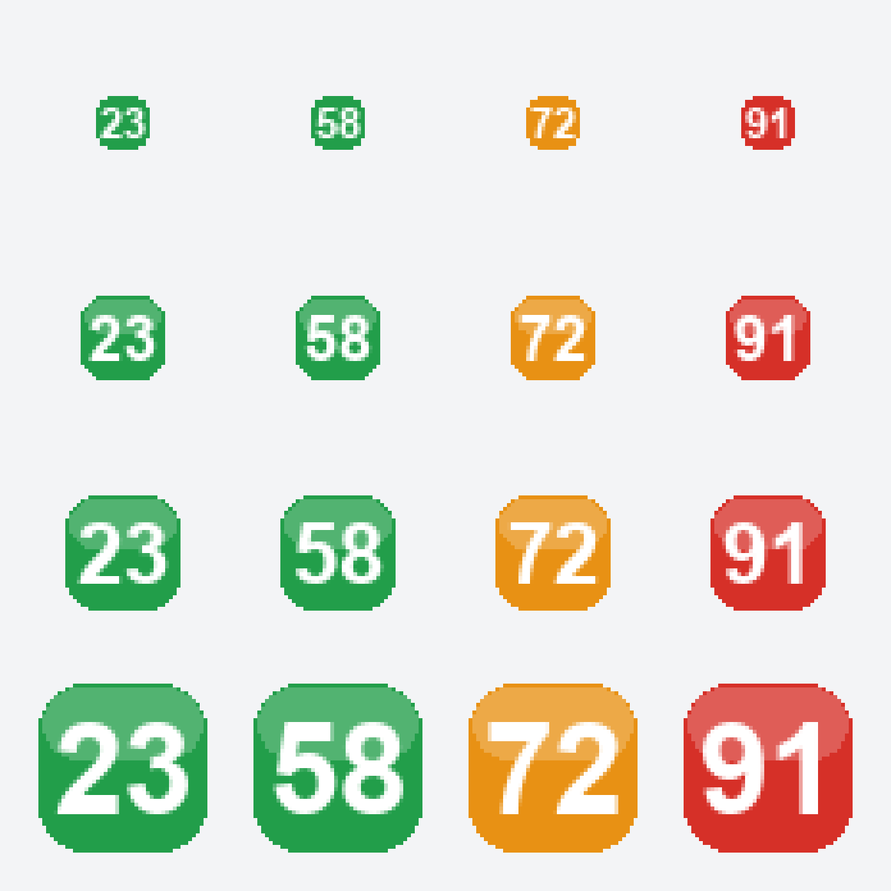

# 内存清理工具（Windows 托盘小工具）

平时完全隐藏，只在**系统托盘**留一个图标：图标上的数字就是**当前内存占用百分比**（绿 < 65% ≤ 橙 < 85% ≤ 红）。
**双击 Alt 键**（0.45 秒内连按两下）立刻清理内存，鼠标悬停图标可看到详细占用，右键图标是功能菜单。



---

## 一、怎么用

| 操作 | 效果 |
| --- | --- |
| **双击 `启动内存清理工具.vbs`** | 静默启动（不弹黑窗口），托盘出现图标 |
| **双击 Alt 键** | 立即清理内存（全局热键，任何程序里都能用） |
| **左键双击托盘图标** | 立即清理内存 |
| **鼠标悬停托盘图标** | 显示 `内存占用 34% (已用 10.8 / 31.8 GB)` |
| **右键托盘图标** | 打开功能菜单 |
| `Ctrl + Alt + M` | 备用热键（仅当键盘钩子安装失败时启用） |

### 右键菜单

```
立即清理内存  (双击 Alt)
────────────────────────
✓ 自动清理: 开  (每 30 分钟, ≥70%)
清理强度: 常规
清理强度: 深度 (手动清理时用, 需管理员)
清理后系统消息: 只清本程序的提示  ▸  不处理系统消息
                                    ✓ 只清本程序的提示
                                      清空整个通知中心
────────────────────────
查看内存详情…
开机自动启动
────────────────────────
关于 / 使用说明
退出
```

* **自动清理**：默认开启，每 30 分钟检查一次，只有内存占用 ≥ 70% 时才真正清理（可在 `settings.json` 里改）。
  **自动清理永远只使用“常规”强度**，不受下面“清理强度”设置影响——因为深度清理会清空文件缓存，定时反复执行只会让系统变慢。
* **清理强度**（只对**手动**清理生效：双击 Alt / 菜单 / 左键双击图标）
  * `常规`（默认，无需管理员）：对每个进程调用 `EmptyWorkingSet`，把闲置的物理内存页交还给系统。安全，无副作用，立刻见效。
  * `深度`（需管理员）：在常规基础上，额外通过 `NtSetSystemInformation` 清空系统工作集、刷新已修改页列表并清空**待机内存列表**（即文件缓存，相当于 RAMMap 的 Empty Standby List）。清空后“可用内存”数字会明显变大，但那本是系统拿来缓存文件的内存，之后开程序/读文件要重新读盘，**属于观感优化而非真提速**，建议只在开大型游戏/渲染前手动来一次。
    请以管理员身份运行本程序：`pythonw E:\...\memclean.py`。
* **清理后系统消息**（默认 = 只清本程序的提示）：每次清理完内存、弹出结果气泡之前，先把**通知中心（操作中心）**里的旧消息清掉，三档可选：
  * `不处理系统消息`：完全不碰通知中心。
  * `只清本程序的提示`（默认）：只删掉本工具自己之前弹的那些提示。传统气泡在 Windows 10 上会被转换成系统通知并**逐条堆积**在通知中心里，堆多了很烦，这一档让本工具始终只保留最新一条。本工具的通知身份（`Microsoft.Explorer.Notification.{GUID}`）会在启动后自动识别并记到 `settings.json` 的 `notify_aumid` 里。
  * `清空整个通知中心`：连同微信、QQ、系统更新等**所有应用**的未读通知一起清掉（相当于点了通知中心右上角的“全部清除”）。**本次清理结果的气泡是在清空之后才弹出的，所以会保留下来。**
  * 执行方式：调用 Windows 自带的 `ToastNotificationManager.History.Clear()`，由 PowerShell 的 WinRT 投影完成，跑在后台线程，**不会卡住托盘和热键**；单次约 1~3 秒（“清空整个通知中心”约 4~6 秒，因为它要遍历 200 多个应用的登记信息）。
* **开机自动启动**：写入 `HKCU\Software\Microsoft\Windows\CurrentVersion\Run`（也可以用 `pythonw memclean.py --autostart on`）。

> **看不到托盘图标？** Windows 10/11 默认会把新出现的托盘图标放进“隐藏的图标”里。
> 点任务栏右下角的 **`^`** 打开折叠区，把本图标**拖到可见区域**即可（或在“设置 → 个性化 → 任务栏 → 选择哪些图标显示在任务栏上”里打开它）。

---

## 二、文件说明

| 文件 | 作用 |
| --- | --- |
| `memclean.py` | 主程序（托盘、图标、热键、清理逻辑全在这一个文件里） |
| `启动内存清理工具.vbs` | 静默启动器，双击即可（自动寻找 pythonw.exe） |
| `关闭内存清理工具.cmd` | 关闭正在运行的工具（只结束本程序的进程） |
| `settings.json` | 配置（首次改动菜单项后自动生成） |
| `icon_preview.png` | 托盘图标效果预览（由 `--icons` 生成） |
| `memclean.log` | 调试日志，仅当设置了环境变量 `MEMCLEAN_DEBUG=1` 时才写 |
| `_dev/` | 开发期的诊断/验证脚本，日常使用不需要 |

---

## 三、命令行参数

```bat
pythonw  memclean.py                 :: 正常启动（无窗口）
python   memclean.py --selftest      :: 自检：内存信息 / 双击 Alt 判定 / 图标生成 / 清理 / 配置
python   memclean.py --clean         :: 只清理一次就退出
python   memclean.py --clean --deep  :: 深度清理一次（建议管理员权限）
python   memclean.py --top 15        :: 列出内存占用最高的 15 个进程
python   memclean.py --clear-notify self   :: 立刻清掉本程序自己的旧提示
python   memclean.py --clear-notify all    :: 立刻清空整个通知中心
python   memclean.py --notify-info         :: 看看通知/AUMID 识别情况
python   memclean.py --autostart on|off|status
python   memclean.py --icons out.png :: 导出托盘图标预览图
python   memclean.py --version
```

---

## 四、配置项 `settings.json`

```json
{
  "auto_enabled": true,        // 自动清理开关
  "auto_interval_min": 30,     // 自动清理间隔（分钟）
  "auto_min_load": 70,         // 达到这个占用率才自动清理（%）
  "level": "normal",           // normal 常规 / deep 深度（deep 只影响手动清理）
  "balloon_on_manual": true,   // 手动清理完成后弹气泡提示
  "hotkey_double_alt": true,   // 双击 Alt 热键
  "autostart": false,          // 开机自启状态（可用菜单切换）
  "clear_notify": "self",      // 清理后系统消息: off 不处理 / self 只清本程序 / all 清空全部
  "notify_aumid": ""           // 自动识别出的"本程序通知"身份, 不用手填
}
```

---

## 五、实现要点

* **托盘图标**：`Shell_NotifyIconW` + 隐藏窗口（`CreateWindowExW`），每 2 秒通过 `GlobalMemoryStatusEx` 取一次占用率；占用率变化时才重画图标（Pillow 画好 32 位带透明通道的位图，经 `CreateDIBSection` + `CreateIconIndirect` 变成 `HICON`），没有变化只更新悬停提示，避免闪烁。
* **双击 Alt**：`SetWindowsHookExW(WH_KEYBOARD_LL)` 低级键盘钩子，逻辑见 `DoubleAltDetector`：
  * 只认“按下—抬起”的完整点击，按住不放的自动重复不会误触发；
  * 两次点击间隔 > 0.45 秒不算；
  * Alt 期间按了别的键（`Alt+Tab`、`Alt+F4`…）本次作废，不影响正常使用；
  * 钩子始终 `CallNextHookEx` 放行，绝不拦截按键。
* **清理**：`K32EmptyWorkingSet` 遍历所有可访问进程 + 压缩自身工作集；深度模式再启用 `SeProfileSingleProcessPrivilege` 调 `NtSetSystemInformation(SystemMemoryListInformation, 4)` 清空待机列表。强度选择由 `effective_level()` 统一决定：**自动清理固定为常规，深度只允许手动触发**。
* **系统消息清理**：`ToastNotificationManager.History.Clear(appUserModelId)`（WinRT，由 PowerShell 投影调用，后台线程执行）。难点在于**识别自己的通知身份**——Windows 给传统气泡分配的是随机的 `Microsoft.Explorer.Notification.{GUID}`，不能自己指定；程序会在弹气泡前后对注册表 `…\Notifications\Settings` 里各发送者的 `LastNotificationAddedTime` 做快照对比，自动认领自己的那个 GUID 并存进 `notify_aumid`。清理顺序刻意安排在“弹结果气泡之前”，这样清空后仍能看到本次结果。
* **图标上的数字**：1~2 位数用大字号加粗，3 位数自动缩小，16px 下依然清楚。
* **不干扰系统**：没有管理员权限时深度清理自动降级；单实例互斥体防止重复启动；资源管理器重启后会自动重新注册托盘图标（`TaskbarCreated` 消息）。

---

## 六、常见问题

**Q：双击 Alt 没反应？**
确认程序在运行（托盘有图标）。若同时开着某些键盘改键/游戏工具，它们可能抢先吃掉按键；也可以在 `settings.json` 里把 `hotkey_double_alt` 设为 `false`，改用 `Ctrl+Alt+M`。

**Q：清理后数字几乎没变？**
说明内存本来就不紧张（系统缓存被合理使用是好事）。清理的主要收益是把长期不用、被换出到页面文件的进程工作集释放掉，第一次运行通常能释放几百 MB ~ 数 GB。

**Q：点“深度清理”没有效果？**
深度清理需要管理员权限。用管理员身份运行 `pythonw.exe memclean.py`。
另外请注意：**自动清理永远走常规强度**，所以即使把强度设成“深度”，定时清理的效果也只是常规；想要深度效果必须手动触发一次（双击 Alt / 菜单）。

**Q：想找回被清理的进程内存？**
不需要，被释放的是闲置页，进程再次用到会自动从页面文件换回，性能不受影响。

**Q：经常弹出“Python”的气泡提示？**
那是 Windows 10 把传统气泡转成了系统通知，应用名来自进程名（本工具没法改这个名字，除非做成带 AppUserModelID 的安装包）。如果嫌吵，可以在菜单里关掉自动清理，或把 `balloon_on_manual` 设为 `false` 只保留图标数字变化。

**Q：“清理后系统消息”是怎么实现的？会不会很慢？**
Windows 只开放了 WinRT 的 `ToastNotificationManager.History.Clear()` 来删除通知中心里的记录，而 Python 没有现成的 WinRT 绑定，所以本工具借 Windows 自带的 PowerShell（其 WinRT 投影）来调用，跑在后台线程里：
* `只清本程序的提示`：约 1.5~3 秒，只操作一个应用自己的记录。
* `清空整个通知中心`：约 4~6 秒，需要遍历 200 多个应用登记项。
期间托盘图标、双击 Alt 热键都不受影响，只是结果气泡会晚几秒出来（内存其实已经释放完了）。清理期间在任务管理器里会短暂看到一个 `powershell.exe` 进程，属于正常现象，跑完自动退出。

**Q：为什么“清空整个通知中心”之后还留着我这次清理的提示？**
因为设计上就是“先清空、再弹本次结果”，这样你能看到这次释放了多少内存。如果你希望连本次结果也不留，把 `clear_notify` 设为 `off` 或 `self` 都行——`self` 模式下每次清理会先删掉上一次的提示，通知中心里始终只有最新一条。

**Q：第一次用提示“还没认准本程序的提示”？**
Windows 给每个传统气泡发送者分配的是一串随机 GUID（`Microsoft.Explorer.Notification.{...}`），程序只能在弹过一次气泡之后，通过对比注册表里的 `LastNotificationAddedTime` 认领自己的那个。正常启动后约 3 秒就会自动识别并记进 `settings.json` 的 `notify_aumid`；可用 `python memclean.py --notify-info` 查看识别结果。
